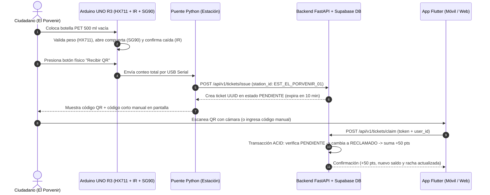

# ♻️ PECOX · Sistema Inteligente de Reciclaje y Gestión del Conocimiento

-006C49?style=for-the-badge)


-3ECF8E?style=for-the-badge&logo=supabase&logoColor=white)


> **PECOX Servicios Ambientales S.A.C.** · Programa piloto de reciclaje inteligente en convenio con la **Municipalidad Distrital de El Porvenir** (Sector Santa Aurora, Trujillo – Perú).

---

## 📌 1. ¿Qué es PECOX y qué problema resuelve?

En los programas de reciclaje tradicionales existen dos problemas críticos:
1. **Falta de trazabilidad física:** las aplicaciones premian al usuario sin comprobar si realmente depositó un material válido.
2. **Dispersión del conocimiento operativo:** lo que los técnicos aprenden al resolver fallas en la estación no se documenta o no coincide con las reglas que ve el ciudadano.

**PECOX** une ambos mundos en una sola plataforma:
* **Estación Física Inteligente (Piloto V1):** recibe y valida botellas **PET vacías de 500 ml** por presencia y peso antes de emitir un ticket QR único.
* **App Ciudadana (Flutter Mobile + Web PWA):** permite ubicar estaciones en **El Porvenir**, escanear el QR de la estación para reclamar puntos reales y canjearlos por recompensas.
* **Sistema de Gestión del Conocimiento (SGC – Modelo SECI):** espacio interno del equipo PECOX donde se aprueban las fichas técnicas (`MAT-PET-01`), se transforman fallas (`INC-004`) en lecciones aprendidas (`LL-MAN-004`) y se miden indicadores (KPIs) del piloto.

---

## 🏗️ 2. Arquitectura Tecnológica (4 Capas)

El sistema utiliza la **Opción 2 (Flutter + Python FastAPI + Supabase PostgreSQL + Estación Arduino/Python)** para mantener un backend limpio en capas, mismo lenguaje Python entre la estación y el servidor, y transacciones ACID en base de datos.

| Capa | Tecnología | Función principal |
| :--- | :--- | :--- |
| **1. Hardware (Estación)** | **Arduino UNO R3 (C/C++)** + Sensor IR + Celda 1 kg (`HX711`) + Servo `SG90` + Buzzer + 2 Botones | Valida el peso de la botella PET (500 ml), abre la compuerta si cumple el criterio, confirma caída por IR y envía el conteo por USB Serial. |
| **2. Puente Local (Edge)** | **Python 3** (`pyserial`, `requests`, `qrcode`) en laptop integrada | Escucha al Arduino; cuando el ciudadano presiona **"Recibir QR"**, solicita un ticket al Backend y muestra el QR en pantalla. |
| **3. Backend & Datos** | **Python (FastAPI)** + **Supabase (PostgreSQL + Auth + Storage + Realtime)** | Expone la API REST (`/docs` Swagger), ejecuta transacciones atómicas para evitar doble reclamo de QR, gestiona roles (RBAC) y almacena fotos de evidencia. |
| **4. Frontend Multiplataforma** | **Flutter (Dart)** — Android + Web PWA | Interfaz unificada de **52 pantallas** (32 vistas ciudadanas + 20 vistas del SGC) con mapa interactivo (`flutter_map`), cámara QR (`mobile_scanner`) y diseño adaptable. |

---

## 🔄 3. Flujo de Validación de Puntos ("Regla de Honestidad")

La aplicación móvil o web **nunca** suma puntos por sí sola. Todo punto nace de una validación física en la estación:



> ⚠️ **Modo Seguro (`FUERA_DE_SERVICIO`):** Si falla un sensor o se pierde la conexión a internet en la estación, el puente Python reporta el estado y la estación aparece como **`FUERA DE SERVICIO`** en el mapa de la app sin emitir tickets.

---

## 📱 4. Módulos y Pantallas Implementadas (52 Vistas)

El frontend en Flutter implementa las **52 pantallas** diseñadas en Figma, accesibles tanto por su flujo natural como desde el botón superior **`52 vistas`** (Catálogo rápido de inspección):

### 🟢 A. Ámbito Ciudadano (`02 – Versión final mejorada` · 32 pantallas)
* **Autenticación y Registro (`01` a `08`):** Login, control de intentos/bloqueo, recuperación de contraseña, registro en 2 pasos con validación de DNI (8 dígitos) y correo.
* **Inicio y Mapa de Estaciones (`09` a `11`):** Dashboard de puntos y racha, mapa interactivo del **Piloto El Porvenir** con estado operativo de estación (`ACTIVA` / `FUERA DE SERVICIO`), materiales aceptados (`PET 500 ml`, `Aluminio`, `Papel y cartón seco`) y botón *"Cómo llegar"* conectado a mapas externos.
* **Escáner QR y Reconocimiento de Producto (`12` a `18`):** Lectura de QR de estación con opción desplegable de **ingreso de código manual**, estados de validación/error, confirmación de `+50 pts` y guía de identificación de botellas PET.
* **Recompensas y Mis Canjes (`19` a `25`):** Catálogo por categorías (*Abarrotes, Limpieza, Otros*), validación de saldo suficiente, generación de código único de canje (`PCX-8042`) e historial de cupones (*Activos, Utilizados, Vencidos*).
* **Perfil, Historial, Notificaciones, Logros y Educación (`26` a `32`):** Estadísticas de impacto (`kg` reciclados y `CO₂` evitado), edición de perfil, notificaciones con marcado de lectura, tabla de ranking y acceso al Centro de Conocimiento.

### 📘 B. Ámbito Interno — Gestión del Conocimiento SECI (`GC` · 20 pantallas)
* **6 Vistas Principales (`GC 01` a `GC 06`):**
  1. `GC 01 Centro de conocimiento`: Biblioteca del equipo con buscador y filtro de pendientes.
  2. `GC 02 Ficha de conocimiento`: Criterios oficiales para recibir PET (`MAT-PET-01 · v1.2`) con trazabilidad de versiones.
  3. `GC 03 Registrar y revisar experiencia`: Documentación de fallas operativas (`INC-004`) con evidencia fotográfica.
  4. `GC 04 Mapa de conocimiento`: Directorio de expertos titulares por área (*Coordinación Ambiental, Mantenimiento, TI, Operaciones*).
  5. `GC 05 Usuarios y permisos`: Control de acceso por rol (RBAC: *Colaboradora, Revisora, Administrador de accesos, Acceso ciudadano*).
  6. `GC 06 Indicadores y reportes`: Tablero del **Piloto El Porvenir** (*33% conocimiento vigente, 4 lecciones aprobadas, 60% de reutilización, 7/10 revisiones en plazo*).
* **14 Vistas de Estados y Recorridos (`GC Estado / *`):** Bandeja de pendientes, aprobación de experiencia, lección aprendida publicada (`LL-MAN-004`), perfil de experta, cambio y guardado de permisos, reporte del periodo, vista pública ciudadana, login de equipo, búsqueda activa (`«PET»`) y preguntas frecuentes (FAQ interna y pública).

---

## 🗄️ 5. Estructura de Carpetas del Proyecto Flutter (`pecox_iskey/`)

```text
pecox_iskey/
├── android/                  # Proyecto nativo Android
├── ios/                      # Proyecto nativo iOS
├── web/                      # PWA Flutter Web (index.html con jsQR + manifest.json)
├── assets/
│   └── icons/                # Íconos vectoriales SVG exportados de Figma
├── lib/
│   ├── core/
│   │   ├── router/
│   │   │   └── app_routes.dart             # Definición de las 52 rutas nombradas
│   │   └── theme/
│   │       ├── app_colors.dart             # Paleta institucional PECOX (#006C49, #A1F2DE, etc.)
│   │       ├── app_typography.dart         # Tipografías Montserrat (títulos) + Inter (cuerpo)
│   │       └── app_theme.dart              # ThemeData centralizado
│   ├── shared/
│   │   └── widgets/                        # Design System reutilizable
│   │       ├── gc_header.dart              # Encabezado GC + acceso rápido a las 52 vistas
│   │       ├── gc_knowledge_card.dart      # Tarjeta estándar de fichas, lecciones y expertos
│   │       ├── gc_info_box.dart            # Cajas informativas de trazabilidad y avisos
│   │       ├── gc_pill_button.dart         # Botones píldora primarios y secundarios
│   │       ├── gc_bottom_nav.dart          # Barras inferiores (Ciudadana y Equipo GC)
│   │       └── p2_common_widgets.dart      # Encabezados, campos validados y filtros
│   ├── features/
│   │   ├── auth/presentation/              # Pantallas 01 a 08 (Login, Recuperación y Registro)
│   │   ├── home_map/presentation/          # Pantallas 09 a 11 (Inicio, Mapa El Porvenir y Detalle)
│   │   ├── scanner/presentation/           # Pantallas 12 a 18 (Escáner QR, Código Manual y Producto)
│   │   ├── rewards/presentation/           # Pantallas 19 a 25 (Recompensas y Mis Canjes)
│   │   ├── profile/presentation/           # Pantallas 26 a 32 (Perfil, Notificaciones, Logros, Tips)
│   │   ├── knowledge/presentation/         # Pantallas GC 01..06 y los 14 Estados SECI
│   │   ├── review/presentation/            # Bandeja de pendientes de revisión
│   │   └── catalog/presentation/           # Selector interactivo de las 52 pantallas
│   ├── app.dart                            # Configuración de MaterialApp y mapa de rutas
│   └── main.dart                           # Punto de entrada de la aplicación
└── pubspec.yaml                            # Dependencias (flutter_map, mobile_scanner, url_launcher, etc.)
```

---

## 🚀 6. Cómo Ejecutar el Proyecto

### Requisitos previos
* **Flutter SDK** `^3.14.0` (con soporte para Web y Android/Windows).
* **Navegador Web** (Edge / Chrome) o **Android Studio** (con NDK `28.2.13676358` si compilas en emulador Android).

### 1. Instalar dependencias
```powershell
cd pecox_iskey
flutter pub get
```

### 2. Ejecutar en Flutter Web (Navegador)
```powershell
flutter run -d edge
```

### 3. Ejecutar en Escritorio Windows (Prueba rápida)
```powershell
flutter run -d windows
```

### 4. Ejecutar en Emulador o Dispositivo Android
```powershell
flutter run -d emulator-5554
```

### 5. Verificar análisis estático y pruebas
```powershell
flutter analyze
flutter test
```

---

## 🗺️ 7. Hoja de Ruta (Roadmap de Integración)

- [x] **Fase 1:** Extracción del Design System de Figma y maquetación completa de las **52 pantallas** en Flutter.
- [x] **Fase 2:** Habilitación de **Flutter Web PWA** (`web/index.html` y `web/manifest.json`) y dependencias multiplataforma (`flutter_map`, `mobile_scanner`, `url_launcher`).
- [ ] **Fase 3:** Creación del esquema PostgreSQL en **Supabase** y API REST en **Python (FastAPI)** (`/tickets/issue`, `/tickets/claim`, `/sgc/documents`).
- [ ] **Fase 4:** Conexión del puente **Python + Arduino UNO R3** en la estación física `EST_EL_PORVENIR_01` (Sector Santa Aurora).
